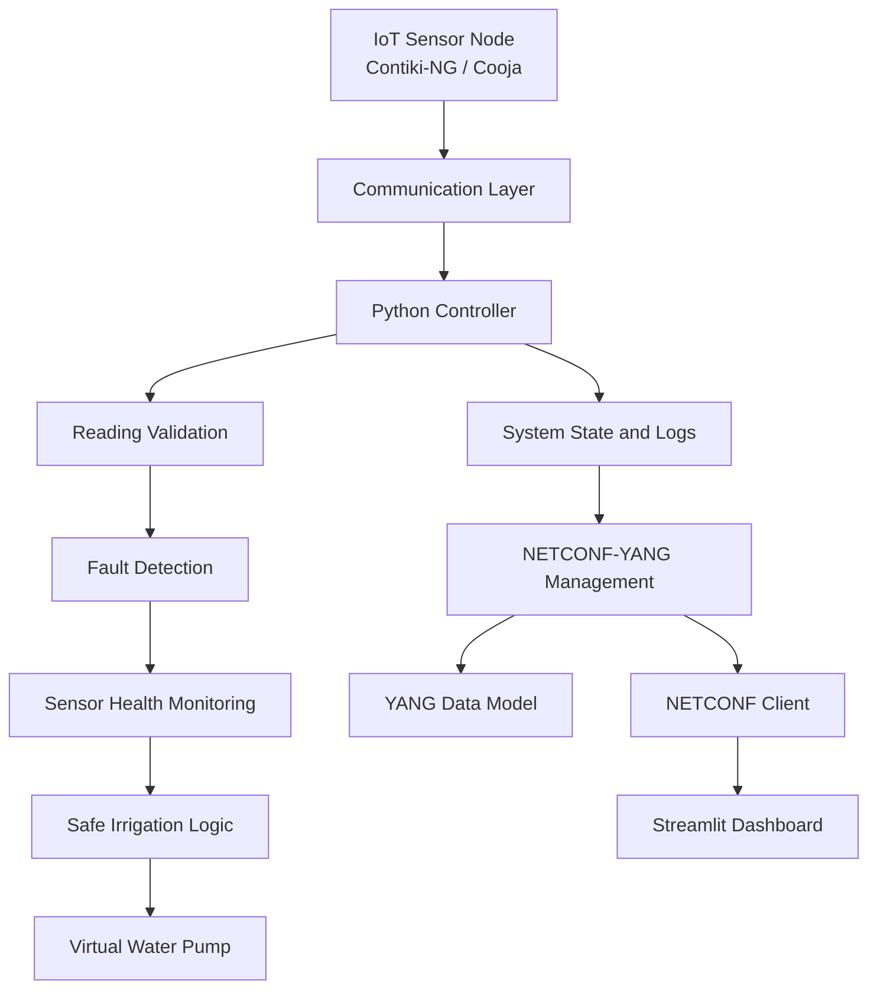

# 🌱 Fault-Aware Smart Irrigation Monitoring and Management Using NETCONF-YANG

<p align="center">
  <strong>An IoT-based smart irrigation system with sensor fault detection, automated pump control, and NETCONF-YANG network management.</strong>
</p>

<p align="center">
  
  
  
  
  
  
</p>

## 📌 Project Overview

This project implements a fault-aware smart irrigation monitoring and management system using IoT technologies and NETCONF-YANG.

The system simulates soil-moisture sensors, detects abnormal sensor behaviour, monitors communication failures, and controls a virtual irrigation pump based on predefined moisture thresholds.

A YANG data model defines the system configuration and operational state, while NETCONF provides remote configuration and monitoring capabilities.

The project also includes a Streamlit dashboard for real-time monitoring, fault visualization, and irrigation management.

## 🎯 Objectives

- Develop an IoT-based smart irrigation monitoring system.
- Simulate soil-moisture sensor readings.
- Detect invalid, missing, delayed, and stale sensor readings.
- Implement fault detection and sensor health monitoring.
- Develop a safe automatic irrigation control mechanism.
- Define configuration and operational data using YANG.
- Implement NETCONF-based configuration and monitoring.
- Visualize sensor status, pump state, and faults through a dashboard.

## 🏗️ System Architecture



## ⚙️ Technology Stack

| Technology | Purpose |
|---|---|
| Python | Fault detection and irrigation controller |
| C | IoT sensor node programming |
| Contiki-NG | IoT operating system |
| Cooja | Wireless sensor network simulation |
| YANG 1.1 | Configuration and operational data modelling |
| NETCONF | Remote configuration and monitoring |
| Netopeer2 | NETCONF server |
| Sysrepo | Configuration and operational datastore |
| libyang | YANG data-model processing |
| ncclient | Python NETCONF client |
| pyang | YANG model validation |
| Streamlit | Interactive monitoring dashboard |
| pytest | Automated testing |

## 🚀 Main Features

### 1. Soil Moisture Monitoring

- Simulates sensor readings at regular intervals.
- Supports Python-based simulation.
- Supports Contiki-NG sensor-node integration.
- Monitors incoming sensor messages.

### 2. Fault Detection

The system detects:

| Fault Scenario | Example |
|---|---|
| Invalid reading | 120% |
| Negative reading | -10% |
| Missing messages | Sensor stops transmitting |
| Delayed messages | Reading arrives late |
| Intermittent communication | Irregular transmissions |
| Malformed message | Incorrect sensor data format |

### 3. Sensor Health Monitoring

Three sensor health states are implemented:

- 🟢 **Healthy:** Valid sensor readings are received.
- 🔴 **Invalid:** An abnormal sensor reading is detected.
- 🟠 **Stale:** No valid sensor reading arrives within the configured timeout.

### 4. Intelligent Irrigation Control

Default configuration:

| Parameter | Default Value |
|---|---:|
| Low moisture threshold | 30% |
| High moisture threshold | 45% |
| Sensor timeout | 15 seconds |
| Sensor transmission interval | 5 seconds |

Pump control policy:

| Condition | Pump State |
|---|---|
| Moisture below 30% and sensor healthy | ON |
| Moisture above 45% and sensor healthy | OFF |
| Moisture between thresholds | Maintain previous state |
| Invalid sensor reading | OFF |
| Stale sensor data | OFF |

**Safety mechanism:** Invalid or stale sensor data can never activate the irrigation pump.

### 5. NETCONF-YANG Management

The system uses the `irrigation-monitoring.yang` module to define configuration and operational information.

Configuration parameters:
- Low moisture threshold.
- High moisture threshold.
- Sensor timeout.

Operational information:
- Current soil moisture.
- Sensor health status.
- Pump state.
- Fault alerts.
- Last valid reading.
- Sensor fault counters.

Supported NETCONF operations:

- `get-config`
- `get`
- `edit-config`

Configuration updates are validated and synchronized with the Python controller.

### 6. Monitoring Dashboard

The Streamlit dashboard displays:

- Current soil moisture.
- Sensor health.
- Virtual pump status.
- Configured thresholds.
- Sensor timeout.
- Fault alerts.
- Reading counters.
- Event logs.

It also provides controls for selecting sensor fault scenarios and modifying irrigation parameters.

## 📂 Project Structure

```text
smart-irrigation-netconf/
│
├── config/
│   ├── settings.json
│   └── netconf.json
│
├── controller/
│   ├── main.py
│   ├── fault_detector.py
│   ├── irrigation_control.py
│   ├── sensor_manager.py
│   ├── config_manager.py
│   ├── state_manager.py
│   └── logging_setup.py
│
├── simulator/
│   ├── sensor_simulator.py
│   └── contiki/
│       ├── sensor_node.c
│       ├── controller_node.c
│       ├── Makefile
│       └── project-conf.h
│
├── netconf/
│   ├── adapter.py
│   ├── netconf_client.py
│   └── netconf_server.py
│
├── dashboard/
│   └── app.py
│
├── yang/
│   └── irrigation-monitoring.yang
│
├── tests/
│   ├── test_fault_detection.py
│   ├── test_irrigation_control.py
│   ├── test_timeout.py
│   └── test_netconf.py
│
├── scripts/
│   ├── install_wsl_deps.sh
│   ├── setup_netconf.sh
│   ├── start_all.sh
│   └── stop_all.sh
│
├── docs/
│   ├── architecture.md
│   ├── demonstration.md
│   ├── project_report.md
│   └── test_results.md
│
├── logs/
├── requirements.txt
└── README.md
```

## 💻 Installation and Setup

### Prerequisites

- Windows 11 or Linux.
- WSL2 with Ubuntu (recommended for Windows).
- Python 3.11 or newer.
- GCC compiler.
- Java Development Kit compatible with your Contiki-NG version.
- Git.
- Contiki-NG and Cooja for IoT simulation.

### Step 1: Clone the repository

```bash
git clone https://github.com/Aadit2308/iot-mini-proejct.git
cd iot-mini-proejct
```

### Step 2: Create Python virtual environment

```bash
python3 -m venv .venv
source .venv/bin/activate
```

For Windows PowerShell:

```powershell
.venv\Scripts\activate
```

### Step 3: Install Python dependencies

```bash
pip install --upgrade pip
pip install -r requirements.txt
```

### Step 4: Install system dependencies

For the complete WSL2 setup:

```bash
bash scripts/install_wsl_deps.sh
```

Follow the installation instructions in the script and repository documentation.

### Step 5: Configure NETCONF

```bash
bash scripts/setup_netconf.sh
```

This step prepares the NETCONF server, datastore, YANG model, and required authentication configuration.

## ▶️ Running the Project

### Option 1: Start the dashboard on Windows

Double-click:

```text
dashboard.bat
```

Open:

http://localhost:8501

### Option 2: Start using the Python simulator

Activate the virtual environment and run:

```bash
python -m controller.main
```

In another terminal:

```bash
python -m simulator.sensor_simulator --scenario normal
```

Start the dashboard:

```bash
streamlit run dashboard/app.py
```

### Available simulation scenarios

```bash
python -m simulator.sensor_simulator --scenario normal
python -m simulator.sensor_simulator --scenario invalid
python -m simulator.sensor_simulator --scenario negative
python -m simulator.sensor_simulator --scenario missing
python -m simulator.sensor_simulator --scenario delayed
python -m simulator.sensor_simulator --scenario intermittent
python -m simulator.sensor_simulator --scenario malformed
python -m simulator.sensor_simulator --scenario mixed
```

### Option 3: Contiki-NG and Cooja

For the Contiki-NG simulation:

```bash
cd ~/contiki-ng/tools/cooja
./gradlew run
```

Use the project-provided launch scripts and documentation to connect the simulated sensor and controller motes.

## 🌐 NETCONF Operations

Retrieve configuration:

```bash
python -m netconf.netconf_client get-config
```

Retrieve operational state:

```bash
python -m netconf.netconf_client get
```

Change sensor timeout:

```bash
python -m netconf.netconf_client set --timeout 10
```

Change moisture thresholds:

```bash
python -m netconf.netconf_client set --low 25 --high 50
```

Run the NETCONF demonstration:

```bash
python -m netconf.netconf_client demo
```

Validate the YANG model:

```bash
pyang --strict --lint yang/irrigation-monitoring.yang
```

## 🧪 Testing

Run automated tests:

```bash
pytest -v
```

For live NETCONF integration tests:

```bash
NETCONF_TESTS=1 pytest -m netconf -v
```

### Test scenarios

| Test | Input / Event | Expected Result |
|---|---|---|
| 1 | Moisture 25% | Healthy, pump ON |
| 2 | Moisture 50% | Healthy, pump OFF |
| 3 | Moisture 120% | Invalid, pump OFF |
| 4 | Moisture -10% | Invalid, pump OFF |
| 5 | No messages for 15 seconds | Stale, pump OFF |
| 6 | Change timeout to 10 seconds | Updated configuration |
| 7 | Restore valid readings | Healthy recovery |
| 8 | Moisture 35% | Maintain previous pump state |
| 9 | Invalid threshold configuration | Configuration rejected |
| 10 | Delayed messages | Fault detection and recovery |

## 📊 Expected Results

The project demonstrates:

- Automated soil-moisture monitoring.
- Detection of abnormal sensor behaviour.
- Communication timeout detection.
- Safe irrigation pump management.
- NETCONF-based configuration updates.
- YANG-based system data modelling.
- Dashboard-based operational monitoring.

See the `docs/` directory for architecture, demonstration instructions, test evidence, and the academic project report.

## 🔐 Safety and Reliability

The system follows these safety rules:

1. Invalid sensor readings are rejected.
2. Stale sensor readings cannot activate the pump.
3. The pump is forced OFF during sensor faults.
4. Configuration values are validated before application.
5. Old or out-of-order messages are discarded.
6. Fault recovery is logged.
7. Controller shutdown forces the virtual pump OFF.

## 🔮 Future Enhancements

- Integration with physical soil-moisture sensors.
- ESP32 or Arduino-based sensor nodes.
- Real relay-based water pump control.
- Multiple agricultural zones.
- MQTT-based communication.
- Cloud-based irrigation analytics.
- Predictive irrigation using machine learning.
- Mobile application integration.

## 📚 Documentation

Additional project documentation:

- [System Architecture](docs/architecture.md)
- [Project Report](docs/project_report.md)
- [Demonstration Guide](docs/demonstration.md)
- [Test Results](docs/test_results.md)

## 👨‍💻 Author

**Aadit**

GitHub: [@Aadit2308](https://github.com/Aadit2308)

Project Repository: [iot-mini-proejct](https://github.com/Aadit2308/iot-mini-proejct)

## 📄 License

This project is intended for educational and academic purposes.

See the LICENSE file for licensing details.
