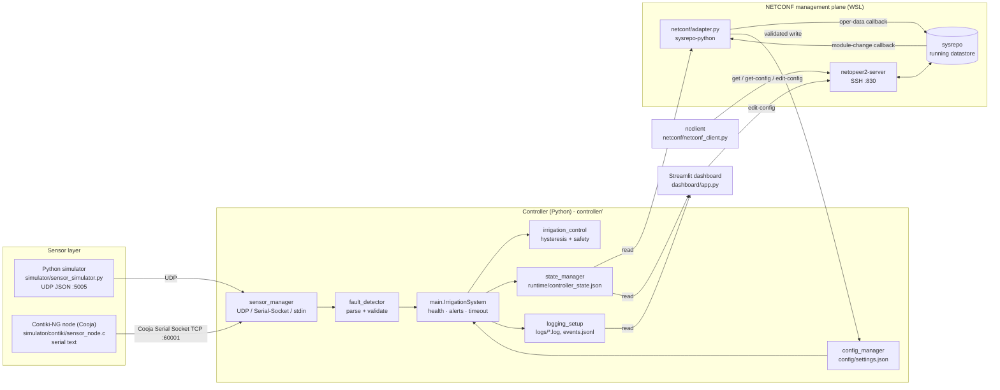
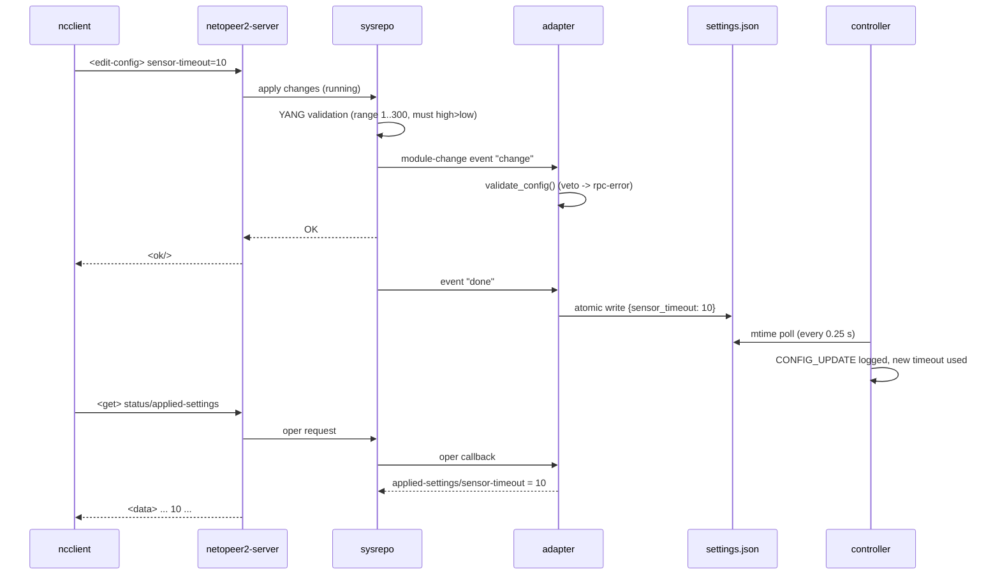
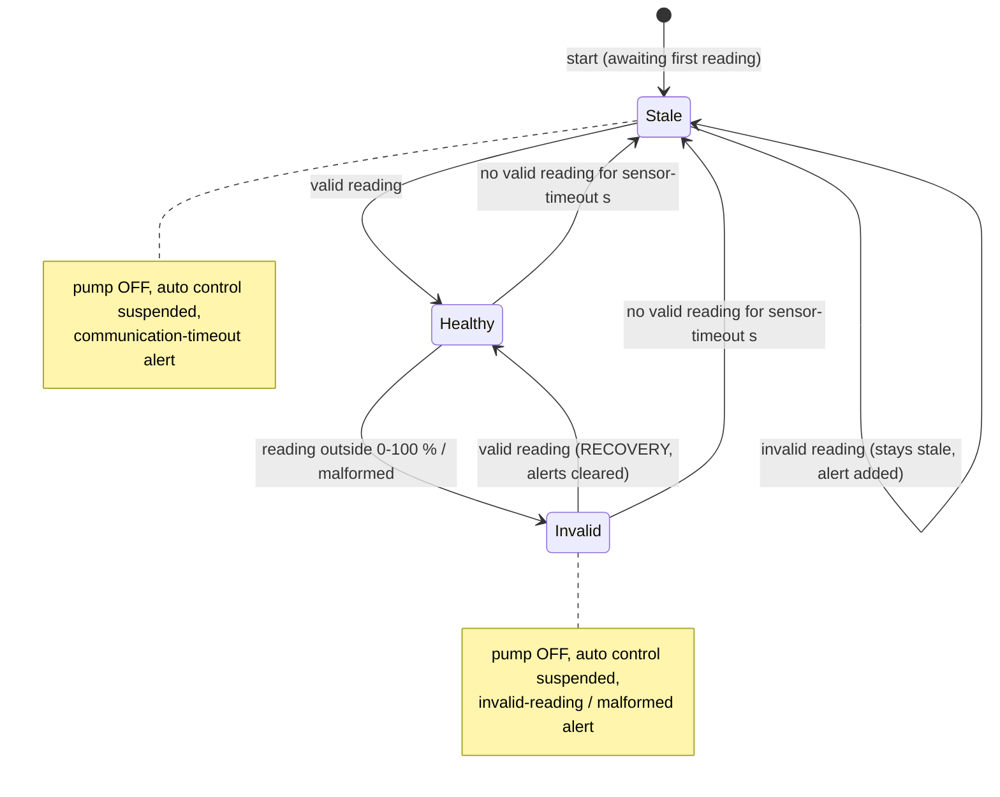
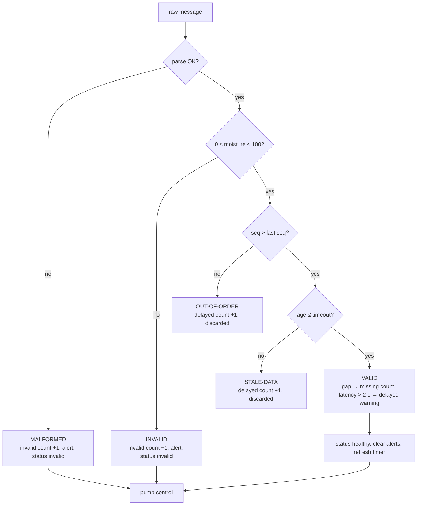
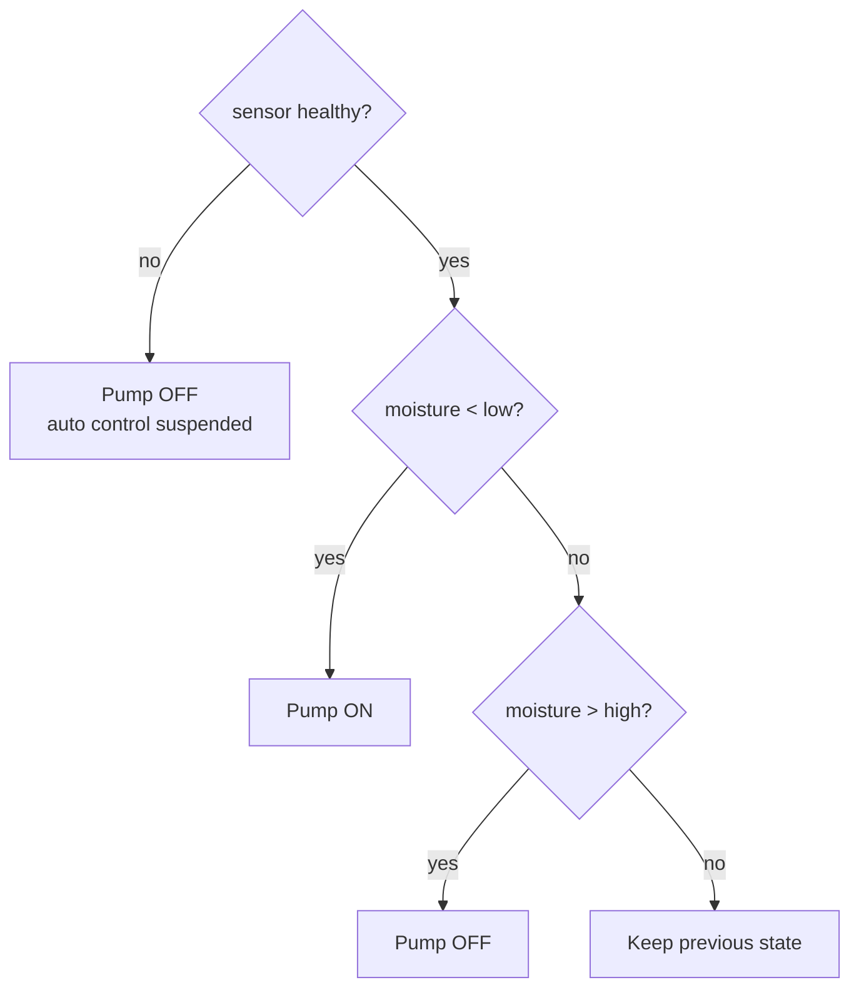

# System Architecture

## 1. Component view



## 2. Why this split

* **The controller has no NETCONF dependency.** It reads `settings.json` and
  writes a JSON state snapshot. It runs (and is fully tested) on any OS.
* **Netopeer2 is the NETCONF server.** It implements the protocol (SSH
  transport, `<hello>`, `<get>`, `<get-config>`, `<edit-config>`, `<rpc-error>`),
  and sysrepo stores the configuration and validates it against the YANG model
  (types, ranges, `must`).
* **The adapter connects sysrepo to the controller.** It subscribes to:
  * *module changes* on `/irrigation-monitoring:irrigation/settings`. On the
    `change` event it validates with the controller's own validator and can
    veto. On `done` it writes `settings.json`.
  * *operational data requests* on `/irrigation-monitoring:irrigation/status`.
    It answers `<get>` from the controller's live snapshot.
  * It also emits a `sensor-health-change` notification when health changes.

## 3. Configuration change sequence (edit-config)



## 4. Sensor health state machine



## 5. Message validation pipeline



## 6. Pump control



## 7. Files and data contracts

| File | Writer | Readers | Content |
|---|---|---|---|
| `config/settings.json` | adapter, dashboard (local mode) | controller | 3 validated config values |
| `runtime/controller_state.json` | controller (every 0.25 s) | adapter, dashboard | full status snapshot |
| `logs/events.jsonl` | controller | dashboard | one JSON event per line |
| `logs/irrigation.log` | controller | humans | timestamped text log |
| `logs/netconf_adapter.log` | adapter | humans | NETCONF-side events |
| `logs/simulator.log` | simulator | humans | what was sent/dropped/delayed |

## 8. Wire formats

Python simulator (UDP datagram):

```json
{"sensor_id": "node-1", "seq": 7, "moisture": 25.0, "timestamp": 1793476800.123, "boot_id": "a1b2c3d4"}
```

Contiki-NG node (serial line):

```
MOISTURE node=1 seq=7 value=25
```

`boot_id` (or a sequence number jumping back by more than 20) marks a sensor
restart, so the sequence check starts again.
