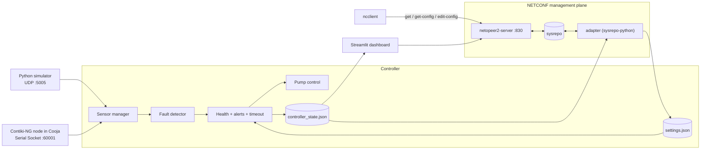
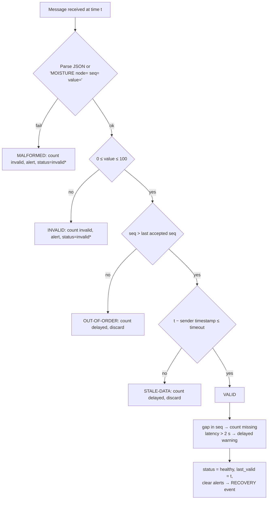
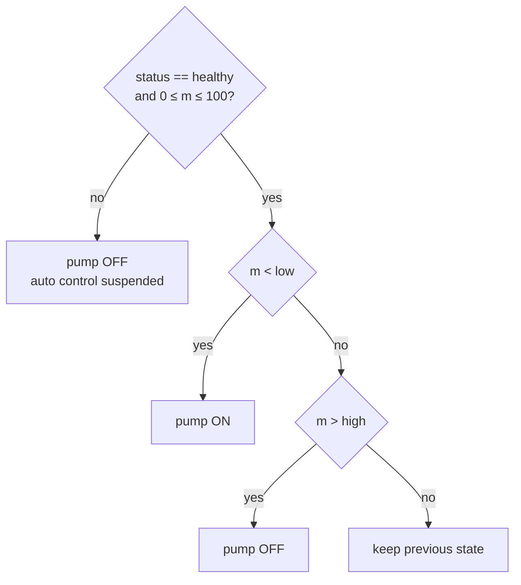

# Fault-Aware Smart Irrigation Monitoring and Management Using NETCONF-YANG

*Mini-Project Report*

---

## Abstract

Automatic irrigation controllers switch a pump based on soil-moisture
readings. A wrong reading can flood a field or let a crop dry out: a sensor
that reports 120 %, a negative value, a corrupted message, or nothing at all.
This project builds a **fault-aware** irrigation controller that validates
every reading and tracks sensor health (*healthy*, *invalid*, *stale*). It
drives a virtual pump with hysteresis between configurable thresholds
(default 30 % and 45 %). It guarantees that invalid or stale data can never
switch the pump on. Sensors are simulated in Python and in **Contiki-NG**
(for the **Cooja** network simulator). The controller is managed with the
IETF standard **NETCONF** protocol, using a **YANG 1.1** data model
(`irrigation-monitoring`) served by **Netopeer2/sysrepo**. Configuration
(`<edit-config>`) reaches the running controller in under a second, and
operational state is retrieved with `<get>`. A **Streamlit** dashboard
visualises the live state. **108 automated pytest tests** cover the ten
required scenarios and the safety invariants; all pass, while 4 live-NETCONF
tests await the server installation.

**Keywords:** IoT, smart irrigation, fault detection, NETCONF, YANG, sysrepo,
Netopeer2, Contiki-NG, Cooja, Streamlit.

---

## 1. Introduction

Agriculture uses about 70 % of the world's fresh water, and much of it is
wasted by fixed-schedule irrigation. Sensor-driven irrigation waters only when
the soil needs it. Field sensors, however, are low-cost devices that work on
lossy wireless links: values drift out of range, packets get lost or arrive
late, and nodes reboot. A controller that trusts every number it receives is
dangerous.

At the same time, IoT deployments need standard remote management. Network
engineering solved this with **NETCONF** (RFC 6241) and the **YANG** modelling
language (RFC 7950). They provide a formally specified configuration model,
transactional edits, server-side validation and a clean split between
configuration and operational state. This project applies that management
approach to an irrigation controller.

## 2. Problem Statement

Design a smart irrigation controller that:

1. receives soil-moisture readings every 5 seconds;
2. detects invalid (outside 0–100 %), malformed, missing, delayed and absent
   readings;
3. never activates the pump based on invalid or stale data;
4. resumes automatic operation when valid data returns;
5. exposes its configuration (thresholds, timeout) and status through
   standards-based NETCONF/YANG management, not an ad-hoc API.

## 3. Aim and Objectives

**Aim:** To build and verify a fault-aware smart irrigation monitoring and
management system using IoT simulation and NETCONF-YANG.

**Objectives**

1. Simulate a soil-moisture sensor with normal and faulty behaviour, in Python
   and in Contiki-NG/Cooja.
2. Implement reading validation and sensor-health tracking with a configurable
   timeout (1–300 s, default 15 s).
3. Implement safe hysteresis pump control with forced-OFF on faults.
4. Model configuration and state in YANG 1.1 and validate the model with pyang.
5. Implement NETCONF `get-config`, `get` and `edit-config` with Netopeer2,
   sysrepo, libyang, libnetconf2 and ncclient, synchronised with the controller.
6. Provide a live dashboard and timestamped logs.
7. Verify the behaviour with automated tests.

## 4. Existing System

| Approach | Limitation |
|---|---|
| Timer-based irrigation | Ignores the actual soil state; wastes water |
| Simple threshold controller (e.g. Arduino `if (m < 30) pumpOn()`) | Trusts every reading; a 120 % or −10 % glitch or a dead sensor leaves the pump in a wrong state; no notion of staleness |
| Cloud IoT dashboards with REST APIs | Ad-hoc, vendor-specific APIs; no formal data model or server-side validation of configuration; no transactional semantics |
| SNMP-based monitoring | Mostly read-only in practice; weak configuration support |

## 5. Proposed System

* **Fault-aware validation pipeline.** It checks parsing, range, ordering and
  age, then classifies each message as valid, invalid, malformed, out-of-order
  or stale-data.
* **Health state machine** (healthy / invalid / stale) with alerts that are
  raised once and cleared on recovery.
* **Safety-first pump logic.** A single pure function decides the pump state.
  Its only ON path requires a healthy sensor and a value in 0–100 %.
* **NETCONF-YANG management.** A YANG 1.1 module defines configuration (rw)
  and state (ro). Netopeer2 serves it over SSH, and sysrepo validates every
  change (including the `must` rule *high > low*) before the controller sees it.
* **Two sensor implementations:** a Python UDP simulator (fallback) and a
  Contiki-NG C node that runs in Cooja.
* **Observability:** a Streamlit dashboard, a text log and a JSON event log.

## 6. Hardware and Software Requirements

### 6.1 Hardware (development)

| Item | Requirement |
|---|---|
| PC | x86-64, 8 GB RAM (project developed on 7.6 GB available to WSL) |
| OS | Windows 11 with WSL2 |
| Sensor/pump | **Virtual**: simulated sensor node and virtual pump (no physical hardware) |

### 6.2 Software

| Software | Version used / required | Role |
|---|---|---|
| Ubuntu (WSL2) | 26.04 LTS | Runtime for NETCONF stack, Contiki-NG |
| Python | 3.13 (Windows), 3.14 (WSL) | Controller, simulator, client, dashboard |
| libyang | latest master (built from source) | YANG parser/validator |
| libnetconf2 | latest master | NETCONF protocol library |
| sysrepo | latest master | YANG datastore |
| Netopeer2 | latest master | NETCONF server |
| sysrepo-python / libyang-python | ≥ 1.7 / ≥ 3.0 | Python bindings for adapter |
| ncclient | 0.7.1 | NETCONF client |
| pyang | 2.7.1 | YANG validation, tree output |
| Streamlit, Altair, pandas | 1.66, bundled, 3.1 | Dashboard |
| pytest | 9.2 | Testing |
| Contiki-NG + Cooja | latest (`~/contiki-ng`), JDK 21 | IoT OS and simulator |
| GCC, CMake | Ubuntu packages | Building C components |

All software is free and open source.

## 7. System Architecture



The layers are:

1. **Sensing layer:** the Python simulator or the Contiki-NG node.
2. **Control layer:** the Python controller.
3. **Management layer:** Netopeer2 + sysrepo + the adapter, accessed by
   ncclient and the dashboard.
4. **Presentation layer:** the dashboard and logs.

Details: `docs/architecture.md`.

## 8. Methodology

The work followed the phased plan below, with tests run at the end of each
phase:

1. Inspect the environment and dependencies.
2. Create the project structure.
3. Build the Python sensor simulator.
4. Build the fault-detection controller.
5. Implement the safe irrigation logic.
6. Create and validate the YANG model (pyang).
7. Implement the NETCONF integration.
8. Integrate Contiki-NG and Cooja.
9. Build the Streamlit dashboard.
10. Run the automated tests and fix failures.
11. Write the documentation.

**Design principles**

* *Pure decision functions* (`decide_pump_state`, `validate_config`,
  `FaultDetector.evaluate`) make the safety logic testable in isolation.
* *Injectable time.* Every controller method accepts an explicit `now`, so
  timeout tests are exact. One test also verifies real wall-clock behaviour.
* *Loose coupling through files.* The controller does not depend on NETCONF
  libraries, so it runs on any OS. The adapter is the only sysrepo-specific
  part.

## 9. Fault Detection Algorithm



\* If the sensor is already *stale*, it stays stale until a valid reading
arrives. This avoids flapping between *invalid* and *stale*.

**Timeout check** (every 0.25 s):

```
reference ← last_valid_time (or start time)
if not already_stale and now − reference ≥ sensor_timeout:
    status ← stale; timeout_events += 1
    raise alert "communication-timeout"
    pump ← OFF; auto control ← suspended
if now − last_message_time ≥ 1.5 × expected_interval:
    log MISSING_MESSAGE once
```

**Reboot handling:** a changed `boot_id`, or a sequence number that jumps back
by more than 20, resets the sequence tracking. Without this, a rebooted node
would be rejected as out-of-order forever.

## 10. Irrigation Control Algorithm



```python
def decide_pump_state(status, moisture, previous, low, high):
    if status is not HEALTHY:               return OFF, suspended
    if moisture invalid / None:             return OFF, suspended
    if moisture < low:                      return ON
    if moisture > high:                     return OFF
    return previous                          # hysteresis band [low, high]
```

The pump starts OFF and is forced OFF on controller shutdown. New thresholds
are applied immediately to the current reading. After a fault, the pump
resumes from OFF, so a 35 % reading after recovery keeps it OFF.

## 11. YANG Model Explanation

File `yang/irrigation-monitoring.yang`: module `irrigation-monitoring`,
namespace `urn:example:irrigation-monitoring`, prefix `im`, YANG 1.1. It
imports `ietf-yang-types` for `date-and-time` and `zero-based-counter64`.

```text
module: irrigation-monitoring
  +--rw irrigation
     +--rw settings
     |  +--rw moisture-threshold-low?    moisture-percent    (default 30.0)
     |  +--rw moisture-threshold-high?   moisture-percent    (default 45.0)
     |  +--rw sensor-timeout?            uint16 1..300 s     (default 15)
     +--ro status
        +--ro sensor-id?  soil-moisture?  sensor-status  status-detail?
        +--ro pump-state  auto-control?  fault-alert  fault-description?
        +--ro last-valid-reading?  last-reading-timestamp?  last-raw-value?
        +--ro total-valid-readings?  total-invalid-readings?  total-timeout-events?
        +--ro total-missing-messages?  total-delayed-messages?  total-recovery-events?
        +--ro applied-settings  (values the controller is actually using)
        +--ro active-alert* [type]  (type, description, raised-at)
  notifications:
    +---n sensor-health-change (previous-status, new-status, pump-state, description)
```

Design choices:

* `typedef moisture-percent`: `decimal64`, 1 fraction digit, range
  0.0..100.0, units percent. It is shared by the thresholds and the reading.
* `sensor-timeout`: `uint16`, range `1 .. 300`, units seconds, default 15.
* **Cross-field rule** on the `settings` container:
  `must "moisture-threshold-high > moisture-threshold-low"` with an
  `error-message` and `error-app-tag`. sysrepo rejects a violating
  `<edit-config>` before it reaches the controller.
* `config false` on `status`, so state can never be written by a client.
* `sensor-health`, `pump-state-type` and `alert-type` are enumerations.
* **`applied-settings`** reports the controller's *effective* configuration,
  so a client can confirm with `<get>` that an edit was really applied.
* Validation: `pyang --strict --lint` reports no errors or warnings.

## 12. NETCONF Implementation

| Element | Implementation |
|---|---|
| Server | **Netopeer2** (`netopeer2-server`, SSH port 830), built on **libnetconf2** |
| Datastore + validation | **sysrepo** with **libyang** |
| Module installation | `sysrepoctl -i yang/irrigation-monitoring.yang` (`netconf/netconf_server.py install`) |
| Application bridge | `netconf/adapter.py` (sysrepo-python) |
| Client | `netconf/netconf_client.py` (ncclient) |

**Adapter**

* `subscribe_module_change` on `/irrigation-monitoring:irrigation/settings`:
  * on the *change* event it computes the resulting config and runs
    `validate_config`. If that raises, the adapter throws
    `SysrepoValidationFailedError`, and Netopeer2 returns `<rpc-error>`.
  * on the *done* event it writes `config/settings.json` atomically. The
    controller detects the new mtime within 0.25 s and logs `CONFIG_UPDATE`.
* `subscribe_oper_data_request` on `/irrigation-monitoring:irrigation/status`
  converts the controller's snapshot (`runtime/controller_state.json`) into
  YANG data. If the snapshot is older than 5 s, it reports the safe state
  (stale, pump off, `controller-offline` alert).
* On start-up it synchronises in one direction. Explicit values already in
  the sysrepo running datastore win; otherwise running is initialised from
  `settings.json`.
* It sends a `sensor-health-change` notification on status transitions.

**Client operations**

```python
with IrrigationNetconfClient() as nc:
    nc.get_config()                    # <get-config source=running> + subtree filter
    nc.edit_config(sensor_timeout=10)  # <edit-config target=running> merge
    nc.wait_until_applied({"sensor_timeout": 10})   # <get> status/applied-settings
    nc.get_status()                    # <get> operational data
```

Example `<edit-config>` payload produced by the client:

```xml
<config xmlns="urn:ietf:params:xml:ns:netconf:base:1.0">
  <irrigation xmlns="urn:example:irrigation-monitoring">
    <settings><sensor-timeout>10</sensor-timeout></settings>
  </irrigation>
</config>
```

## 13. Cooja Simulation

`simulator/contiki/sensor_node.c` is a Contiki-NG process with an `etimer`
of 5 s. It prints `MOISTURE node=<id> seq=<n> value=<v>` on the serial port.
The scenario tables reproduce the Python simulator's fault patterns:

* **Missing** consumes sequence numbers without printing.
* **Delayed** holds messages in a small queue and releases them four
  intervals later, so they arrive out of order.
* **Intermittent** uses `random_rand()` for 30 % loss and 10 % delay.
* **Malformed** prints `value=ERR#`.

The scenario is selected with `FAULT_SCENARIO` in `project-conf.h`.

In Cooja, one *Cooja mote* runs the firmware. The **Serial Socket (SERVER)**
plugin exposes its serial output on TCP 60001, and the controller connects
with `--source serial`. The simulation must run at 100 % speed, because the
controller uses wall-clock timeouts. The same code builds with
`make TARGET=native` as a Linux process whose output can be piped into the
controller (`--source stdin`). Step-by-step instructions are in
`docs/demonstration.md` §4.

## 14. Python Implementation

| Module | Responsibility |
|---|---|
| `controller/config_manager.py` | Typed `IrrigationConfig`, `validate_config` (types, ranges, high > low, integer timeout), atomic JSON writes, change listeners, mtime-based reload |
| `controller/fault_detector.py` | Parsing of both wire formats, range/ordering/age checks, gap and reboot detection |
| `controller/irrigation_control.py` | `SensorStatus`, `PumpState`, pure `decide_pump_state`, `IrrigationController` |
| `controller/state_manager.py` | Counters, alerts, recent events, JSON snapshot |
| `controller/sensor_manager.py` | UDP, Cooja Serial Socket (auto-reconnect) and stdin sources feeding one queue |
| `controller/main.py` | `IrrigationSystem` core plus CLI loop (poll, process, reload config, check timeouts, save state) |
| `controller/logging_setup.py` | Text and JSON-lines logging with categories |
| `simulator/sensor_simulator.py` | 8 scenarios; real-time scheduling of delayed delivery |

**Log categories:** `VALID_READING`, `INVALID_READING`, `MALFORMED_MESSAGE`,
`MISSING_MESSAGE`, `DELAYED_MESSAGE`, `TIMEOUT`, `PUMP_STATE_CHANGE`,
`AUTO_CONTROL`, `CONFIG_UPDATE`, `CONFIG_REJECTED`, `RECOVERY`, `ALERT`,
`SYSTEM`. Every line carries a millisecond timestamp.

## 15. Dashboard

`dashboard/app.py` (Streamlit) refreshes every 2 s and shows:

* moisture, sensor health, pump and auto-control state (icons plus text, so
  meaning never depends on colour alone);
* thresholds, timeout and last valid reading time;
* valid, invalid, timeout, missing, delayed and recovery counters;
* active fault alerts;
* a moisture line chart with the low/high thresholds drawn as labelled
  reference lines, with a hover tooltip.

Controls: start/stop the controller and simulator, choose the fault scenario
and interval, and change thresholds and timeout. Changes are applied **via
NETCONF `<edit-config>`** when the server is reachable, or via the validated
local settings file otherwise. A log viewer filters by category.

All values are read from the running controller's state file and event log.

## 16. Test Cases and Observation Table

| # | Test case | Input | Expected | Observed | Result |
|---|---|---|---|---|---|
| 1 | Low moisture | 25 % | Healthy, pump ON | Healthy, pump ON | PASS |
| 2 | High moisture | 50 % | Healthy, pump OFF | Healthy, pump OFF | PASS |
| 3 | Over-range | 120 % | Invalid, alert, pump OFF | Invalid, alert, pump OFF | PASS |
| 4 | Negative | −10 % | Invalid, alert, pump OFF | Invalid, alert, pump OFF | PASS |
| 5 | No messages | 15 s silence | Stale, pump OFF | Healthy at 14.5 s, stale at 15.0 s, pump OFF | PASS |
| 6 | NETCONF timeout | edit-config 10 s | Controller applies 10 s | Local sync path: stale exactly at 10.0 s. Live NETCONF run pending server install | PARTIAL |
| 7 | Recovery | valid after stale | Healthy, auto resumes | Healthy, alerts cleared, auto control active | PASS |
| 8 | Hysteresis | 35 % | Maintain state | ON→ON, OFF→OFF | PASS |
| 9 | Bad config | high ≤ low | Reject | Rejected, config unchanged | PASS |
| 10 | Delayed | late / held messages | Detect + recover | Delayed logged; stale; recovery; late copies discarded | PASS |

Totals from the final run: **108 passed, 4 skipped** (the skipped tests need a
live Netopeer2 server). Full output is in `docs/test_results.md`.

## 17. Results and Discussion

* **Safety held in every scenario.** In the live end-to-end run, every 120 %,
  −10 %, malformed and timeout event forced the pump OFF within the same
  processing cycle (≤ 3 ms after receipt in the log timestamps). Delayed copies
  carrying 20 % (which would have switched the pump ON) were discarded.
* **Timeout detection is exact** to the 0.25 s loop resolution. With a 3 s
  timeout the live log shows stale at 3.1 s.
* **Recovery is automatic.** It clears alerts and logs RECOVERY. After a fault
  the pump resumes from OFF, which is the conservative choice.
* **The test suite found a real bug.** A malformed message was also counted as
  missing. It was fixed and a regression test added.
* **The Contiki node and the Python simulator are consistent.** The C node's
  output (compiled on the host with stub headers) was classified correctly by
  the controller: 3 invalid, 7 missing, 3 delayed.
* **Missing vs delayed.** A message held back beyond the next reading is first
  counted as *missing* (sequence gap) and later as *delayed* when it arrives.
  Both counts are correct from the controller's point of view at the time.

## 18. Limitations

* The sensor and pump are virtual; there is no field hardware.
* There is a single sensor and a single pump (no zones).
* The controller and NETCONF adapter communicate through files on one host.
  This is simple and robust, but not suitable for distributed deployment.
* The adapter needs root to access sysrepo (default permissions).
* Delay detection without sender timestamps (Contiki serial format) relies on
  sequence numbers only.
* Live NETCONF and real Contiki-NG/Cooja runs must be repeated on the target
  WSL environment (see `docs/test_results.md` §7).

## 19. Future Enhancements

* Multiple sensors and zones (`list zone` in YANG), with sensor fusion and
  majority voting.
* Physical deployment: ESP32/nRF52 sensor node running Contiki-NG, relay-driven pump.
* Transport readings over 6LoWPAN/RPL with CoAP or MQTT-SN instead of serial.
* NETCONF notifications subscribed by the dashboard (RFC 5277) and YANG-Push
  (RFC 8641) for streaming telemetry.
* Weather-forecast-aware irrigation and evapotranspiration models.
* NACM (RFC 8341) access control and TLS (RFC 7589) transport.
* Persisting history in a time-series database.

## 20. Conclusion

The project shows that a simple threshold irrigation controller becomes safe
and manageable once it treats sensor data as untrusted, models health
explicitly, and uses standard network-management tooling. Validation of
range, format, ordering and freshness, plus a single fail-safe decision
function, ensures that invalid or stale data never activates the pump. This
is verified by an automated test suite in which all ten required cases pass
(Test 6's live NETCONF portion pending installation). The YANG 1.1 model and
NETCONF stack (Netopeer2, sysrepo, libyang, libnetconf2, ncclient) provide
validated, transactional configuration and structured operational state
instead of an ad-hoc API.

## 21. References

1. R. Enns, M. Bjorklund, J. Schoenwaelder, A. Bierman, "Network Configuration Protocol (NETCONF)", RFC 6241, IETF, 2011.
2. M. Bjorklund, "The YANG 1.1 Data Modeling Language", RFC 7950, IETF, 2016.
3. J. Schoenwaelder, "Common YANG Data Types", RFC 6991, IETF, 2013.
4. M. Wasserman, "Using the NETCONF Protocol over Secure Shell (SSH)", RFC 6242, IETF, 2011.
5. A. Bierman, "Guidelines for Authors and Reviewers of Documents Containing YANG Data Models", RFC 8407, IETF, 2018.
6. S. Chisholm, H. Trevino, "NETCONF Event Notifications", RFC 5277, IETF, 2008.
7. CESNET, *libyang*, *libnetconf2*, *sysrepo*, *Netopeer2*, https://github.com/CESNET
8. Contiki-NG Project, *Contiki-NG: The OS for Next Generation IoT Devices*, https://www.contiki-ng.org
9. F. Österlind et al., "Cross-Level Sensor Network Simulation with COOJA", Proc. IEEE LCN, 2006.
10. ncclient project, *Python library for NETCONF clients*, https://github.com/ncclient/ncclient
11. pyang project, *An extensible YANG validator and converter in Python*, https://github.com/mbj4668/pyang
12. Streamlit Inc., *Streamlit documentation*, https://docs.streamlit.io
13. FAO, *AQUASTAT: Water uses*, Food and Agriculture Organization of the United Nations.
